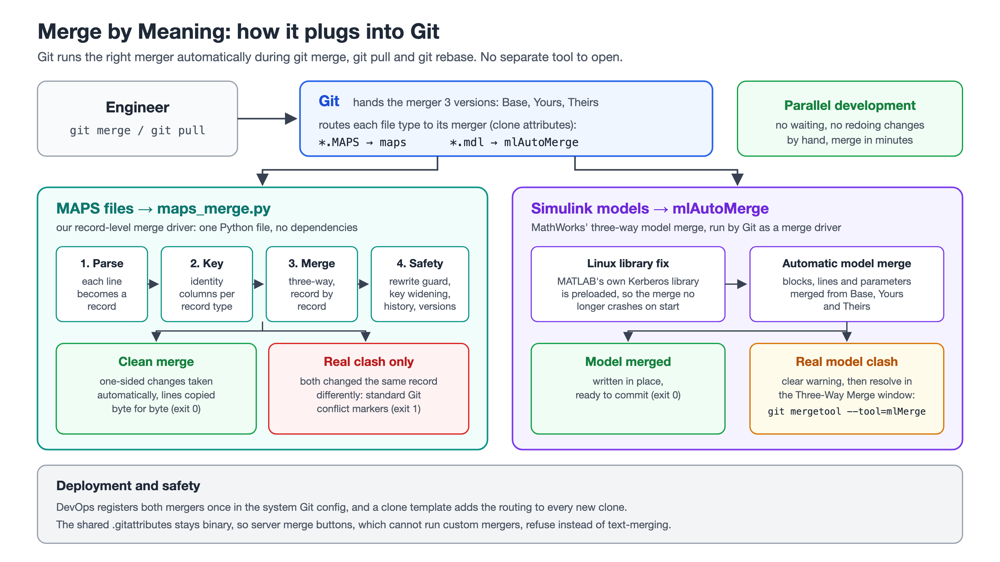
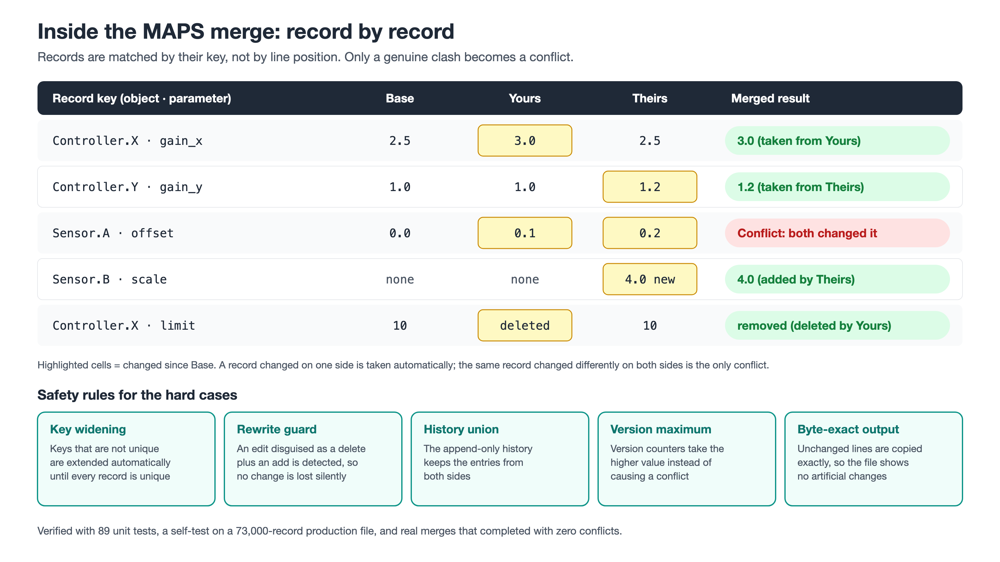

# Merge by Meaning Ends the Wait in Parallel Simulink and MAPS Development

Two engineers, one file, and days of waiting. Simulink control models and MAPS parameter files are core artifacts of our control software, yet Git cannot merge them. When two engineers change the same file in parallel, one must wait for the other's delivery or re-enter their changes by hand on top of it. That costs hours per overlap and invites copy errors in critical machine parameters.

We created Merge by Meaning, a tool that lets engineers work on these files in parallel and combine their work automatically with a normal git merge or git pull. It saves about 5 engineering hours per overlapping delivery and removes the wait between deliveries.

The key insight is that Git's line-based merge is the wrong tool for structured engineering data. A MAPS file is a set of records, not a sequence of lines, and a Simulink model is a network of linked blocks. They must be merged by meaning, not by text.

For MAPS files, we built a structure-aware merge engine as a single dependency-free Python script that Git runs as a custom merge driver. It parses every line into a record, identifies each record by the key columns of its record type, such as object, parameter, dataset and instance, and runs a three-way merge record by record against the common base. One-sided changes are taken automatically; only a real clash, where both engineers changed the same record differently, becomes a standard Git conflict. Safety rules cover the cases a naive merge gets wrong: non-unique keys are widened automatically, edits disguised as a delete plus an add are caught instead of lost, the append-only history is combined from both sides, version counters take the higher value, and every line is copied byte for byte.

For Simulink models, we connected MathWorks' three-way model merge to Git as a second merge driver and fixed a Linux library conflict that had made it crash on our machines. A model that cannot be merged automatically is flagged with a clear warning and resolved in the Three-Way Merge window.

The design is safe by default. The shared repository settings keep these files binary, so server merge buttons, which cannot run custom drivers, refuse them instead of producing a broken text merge. DevOps can enable the tool for all users centrally. It was verified with 89 unit tests, a self-test on a 73,000-record production file, and real merges that completed with zero conflicts.

